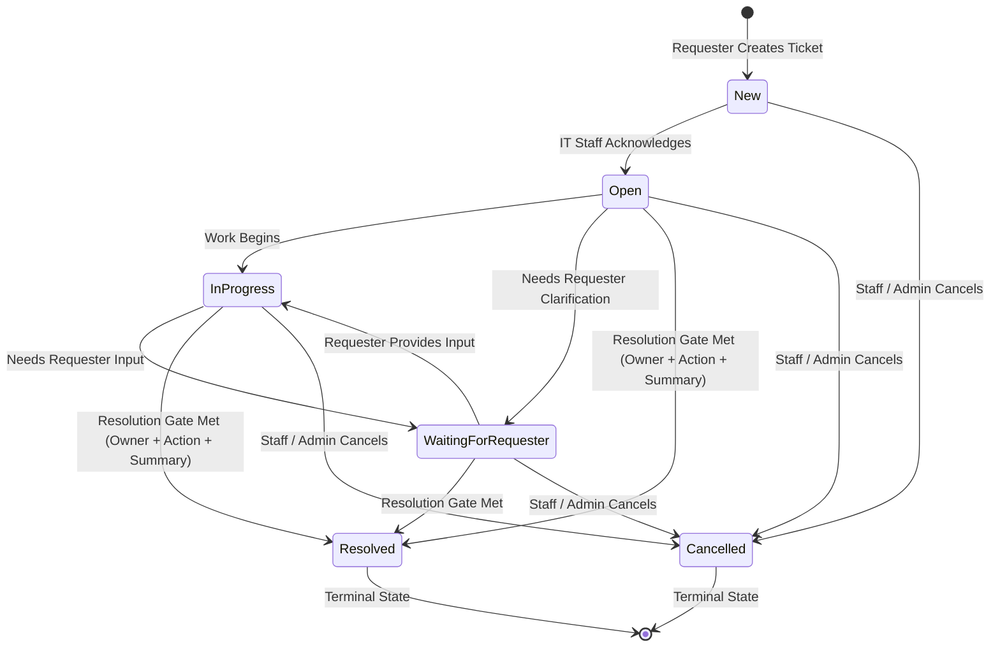

# Lab 4 Submission Evidence: Working Ticket Workflow

**Author:** Iris French (67070503478) — GitHub: [@feliscatus555](https://github.com/feliscatus555)  
**Task:** Part 7: Working Ticket Workflow (`docs/lab-04/SE_Lab_4.pdf`, Section 14, Item 7 — 5 Points)  
**Specification Reference:** [`docs/lab-04/specification.md`](file:///home/iris/Documents/toktickit/docs/lab-04/specification.md) (BR-05 to BR-10, FR-54 to FR-60)  
**Test Reference:** [`docs/lab-04/tests.md`](file:///home/iris/Documents/toktickit/docs/lab-04/tests.md) (`server/tests/lab-04/ticket-workflow.api.test.ts`)  
**Storage Directory:** [`artifacts/lab-04/screenshots/ticket-workflow/`](file:///home/iris/Documents/toktickit/artifacts/lab-04/screenshots/ticket-workflow/)

---

## 1. Overview & Verification Checklist

| # | Workflow Requirement | Screenshot File | Verification Summary |
|---|---|---|---|
| 1 | **Permitted Ticket Transitions** | [`01-permitted-status-transitions.png`](file:///home/iris/Documents/toktickit/artifacts/lab-04/screenshots/ticket-workflow/01-permitted-status-transitions.png) | Active status dropdown (`#next-status-select`) on `InProgress` ticket presenting only valid next states: `Waiting for Requester`, `Resolved`, `Cancelled`. |
| 2 | **Terminal State Lock** | [`02-terminal-state-cancelled.png`](file:///home/iris/Documents/toktickit/artifacts/lab-04/screenshots/ticket-workflow/02-terminal-state-cancelled.png) | Cancelled ticket (`TKT-2026-00004`) showing `Cancelled (Terminal State)` with status dropdown disabled to prevent illegal transitions from terminal state. |
| 3 | **Invalid Transition Rejection** | [`03-invalid-transition-rejected.png`](file:///home/iris/Documents/toktickit/artifacts/lab-04/screenshots/ticket-workflow/03-invalid-transition-rejected.png) | Attempting illegal status jump (e.g. `New` directly to `Resolved`) rejected with HTTP `422 INVALID_STATUS_TRANSITION` and inline validation alert. |
| 4 | **Stable Ordering (Work Logs)** | [`04-stable-ordering-actions-chronological.png`](file:///home/iris/Documents/toktickit/artifacts/lab-04/screenshots/ticket-workflow/04-stable-ordering-actions-chronological.png) | Actions Taken work log deterministically ordered chronologically by `actionDateTime ASC` and secondary `createdAt ASC`, invariant across reloads. |
| 5 | **Stable Ordering (Queue)** | [`05-stable-ordering-queue-deterministic.png`](file:///home/iris/Documents/toktickit/artifacts/lab-04/screenshots/ticket-workflow/05-stable-ordering-queue-deterministic.png) | Staff Queue showing deterministic ordering with secondary tie-break on ID/createdAt across pagination and sorting keys. |
| 6 | **Append-Only Behavior (Work Logs)** | [`06-append-only-audit-log.png`](file:///home/iris/Documents/toktickit/artifacts/lab-04/screenshots/ticket-workflow/06-append-only-audit-log.png) | Permanent historical work logs on `TKT-2026-00003` showing immutable author attribution, timestamps, and complete absence of delete operations. |
| 7 | **Append-Only History (Notes & Comments)** | [`07-append-only-comments-notes.png`](file:///home/iris/Documents/toktickit/artifacts/lab-04/screenshots/ticket-workflow/07-append-only-comments-notes.png) | Append-only public comments and private internal notes thread maintaining immutable chronological audit history. |
| 8 | **Role-Appropriate Visibility (Staff)** | [`08-role-visibility-staff-view.png`](file:///home/iris/Documents/toktickit/artifacts/lab-04/screenshots/ticket-workflow/08-role-visibility-staff-view.png) | IT Staff view (`Sarah Johnson`): full workflow controls visible, including status dropdown, owner selector, priority selector, internal notes, and add/edit actions. |
| 9 | **Role-Appropriate Visibility (Requester)** | [`09-role-visibility-requester-view.png`](file:///home/iris/Documents/toktickit/artifacts/lab-04/screenshots/ticket-workflow/09-role-visibility-requester-view.png) | Requester view (`Ananya Srisuk` on same ticket): internal notes tab completely hidden, status & assignment controls hidden, read-only actions table. |

---

## 2. Permitted Status Transitions Matrix

The Finite State Machine strictly enforces valid transitions per business rules (**BR-05**, **BR-06**, **BR-08**):



| Current Status | Permitted Next Statuses | Blocked / Invalid Statuses |
|---|---|---|
| **New** | `Open`, `Cancelled` | `InProgress`, `WaitingForRequester`, `Resolved` *(requires acknowledgment first)* |
| **Open** | `InProgress`, `WaitingForRequester`, `Resolved`, `Cancelled` | `New` *(cannot revert to unacknowledged)* |
| **InProgress** | `WaitingForRequester`, `Resolved` *(Gate)*, `Cancelled` | `New`, `Open` |
| **WaitingForRequester** | `InProgress`, `Resolved` *(Gate)*, `Cancelled` | `New`, `Open` |
| **Resolved** | Terminal State *(or Reopened if permitted)* | `New`, `Open`, `InProgress` |
| **Cancelled** | Terminal State | Cannot transition to any status |

---

## 3. Visual Evidence Gallery

### 1. Permitted Ticket Transitions
````carousel

<!-- slide -->

````
- **Paths:** 
  - Closeup: [`artifacts/lab-04/screenshots/ticket-workflow/01b-permitted-status-transitions-closeup.png`](file:///home/iris/Documents/toktickit/artifacts/lab-04/screenshots/ticket-workflow/01b-permitted-status-transitions-closeup.png)
  - Full Page: [`artifacts/lab-04/screenshots/ticket-workflow/01-permitted-status-transitions.png`](file:///home/iris/Documents/toktickit/artifacts/lab-04/screenshots/ticket-workflow/01-permitted-status-transitions.png)
- **Verification:** Status selector on `InProgress` ticket presenting only permitted workflow targets (`Waiting for Requester`, `Resolved` [via Resolution Gate], and `Cancelled` [Terminal State]) with state validation badges, while regression transitions (`New`, `Open`) are strictly forbidden.

### 2. Terminal State Lock (Cancelled Status)

- **Path:** [`artifacts/lab-04/screenshots/ticket-workflow/02-terminal-state-cancelled.png`](file:///home/iris/Documents/toktickit/artifacts/lab-04/screenshots/ticket-workflow/02-terminal-state-cancelled.png)
- **Verification:** Cancelled ticket displaying `Cancelled (Terminal State)` with disabled select control to prevent illegal state regression.

### 3. Invalid Transition Rejection

- **Path:** [`artifacts/lab-04/screenshots/ticket-workflow/03-invalid-transition-rejected.png`](file:///home/iris/Documents/toktickit/artifacts/lab-04/screenshots/ticket-workflow/03-invalid-transition-rejected.png)
- **Verification:** Attempting illegal transition from `New` directly to `Resolved` rejected with HTTP `422 INVALID_STATUS_TRANSITION`.

### 4 & 5. Stable Ordering
````carousel

<!-- slide -->

````
- **Paths:** [`04-stable-ordering-actions-chronological.png`](file:///home/iris/Documents/toktickit/artifacts/lab-04/screenshots/ticket-workflow/04-stable-ordering-actions-chronological.png) & [`05-stable-ordering-queue-deterministic.png`](file:///home/iris/Documents/toktickit/artifacts/lab-04/screenshots/ticket-workflow/05-stable-ordering-queue-deterministic.png)
- **Verification:** Work logs ordered deterministically by `actionDateTime ASC` and `createdAt ASC`. Queue sorting provides deterministic secondary tie-breaking on ticket ID/createdAt.

### 6 & 7. Append-Only Work Logging & Audit Trails
````carousel

<!-- slide -->

````
- **Paths:** [`06-append-only-audit-log.png`](file:///home/iris/Documents/toktickit/artifacts/lab-04/screenshots/ticket-workflow/06-append-only-audit-log.png) & [`07-append-only-comments-notes.png`](file:///home/iris/Documents/toktickit/artifacts/lab-04/screenshots/ticket-workflow/07-append-only-comments-notes.png)
- **Verification:** Actions Taken and Notes/Comments logs represent append-only audit trails. Deletion operations are intentionally omitted from both API and UI.

### 8 & 9. Role-Appropriate Visibility Comparison
````carousel

<!-- slide -->

````
- **Paths:** [`08-role-visibility-staff-view.png`](file:///home/iris/Documents/toktickit/artifacts/lab-04/screenshots/ticket-workflow/08-role-visibility-staff-view.png) & [`09-role-visibility-requester-view.png`](file:///home/iris/Documents/toktickit/artifacts/lab-04/screenshots/ticket-workflow/09-role-visibility-requester-view.png)
- **Verification:** Direct comparison on the exact same ticket (`TKT-2026-00003`):
  - **IT Staff (`Sarah Johnson`):** Has access to `#next-status-select`, `#ticket-owner-select`, `#it-priority-select`, `#tab-btn-internal-notes`, and "+ Add Action Taken".
  - **Requester (`Ananya Srisuk`):** Internal notes tab is completely hidden, status and assignment are read-only, and Actions Taken is displayed without write/edit controls.
