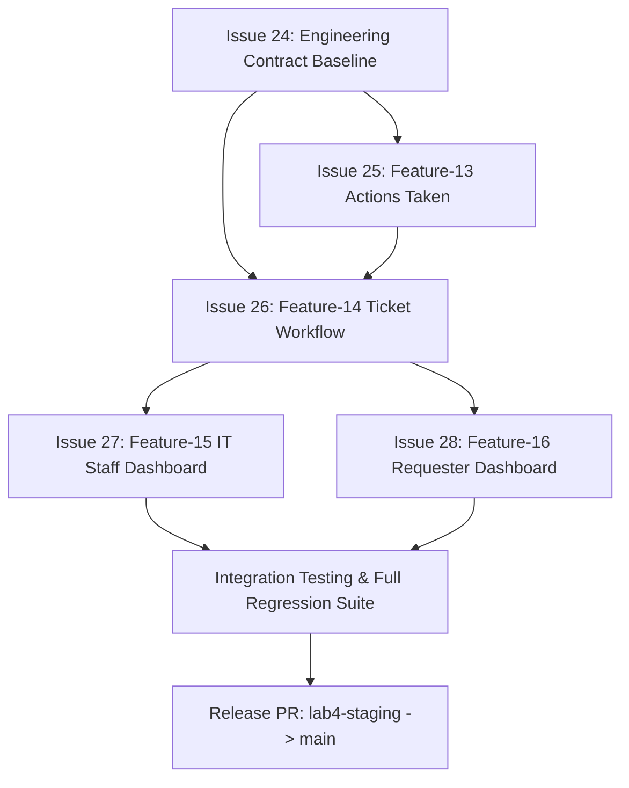
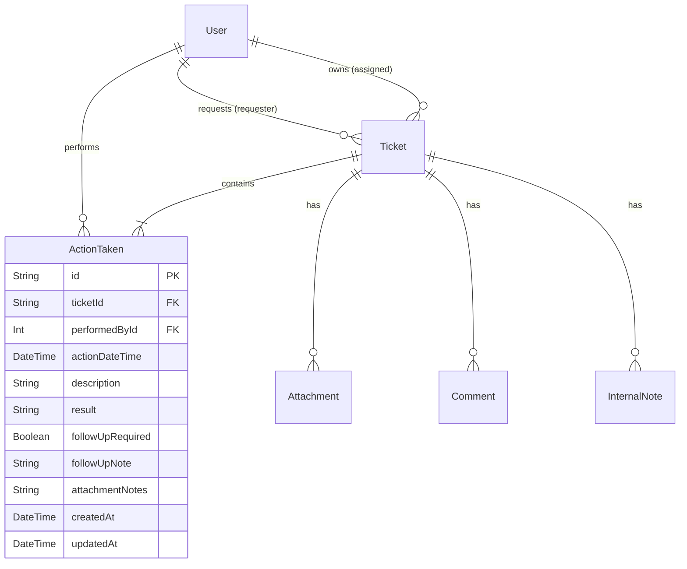

# Lab 4 Sprint Engineering Specification — TokTickIT

## Document Control & Citation Reference
* **Document Status**: Sprint 4 Engineering Specification Baseline
* **Target Sprint**: Lab 4 — TokTickIT Actions Taken, Dashboards, and Final Regression
* **Target Branch**: `lab4-staging`
* **Base References**:
  * `docs/lab-04/SE_Lab_4.pdf` (Lab 4 Labsheet & Stakeholder Handout)
  * `docs/lab-03/specification.md` (Lab 3 Baseline Engineering Specification)
  * `server/prisma/schema.prisma` (PostgreSQL Prisma Schema Baseline)

---

## 1. Sprint Goal
Deliver the final operational increments of the TokTickIT service desk by implementing child-level Actions Taken tracking, enforcing authoritative ticket lifecycle and resolution business rules, deploying role-appropriate operational dashboards for Requesters, IT Staff, and Administrators, and hardening the full application across Labs 1 through 3 under the Zen Green design system (`docs/lab-04/SE_Lab_4.pdf`, Section 1, Section 7).

---

## 2. Stakeholder Request Interpretation
The stakeholder requires TokTickIT to bridge the gap between ticket management and actual technical execution (`docs/lab-04/SE_Lab_4.pdf`, Section 3). While IT Staff can currently receive tickets and communicate via public comments and internal notes, there is no structured record of technical actions taken. Sprint 4 introduces an "Actions Taken" child work structure under each ticket, capturing Action Date/Time, Action Description, Result, Performed by (auto-populated from authenticated staff), Follow-Up Required flag, Follow-up Note (mandatory when follow-up is needed), and Attachment Notes. While a ticket retains a single primary Ticket Owner for coordination, any authorized IT Staff member may record actions. Requesters may indicate that an issue appears resolved, but formal resolution requires IT Staff verification. Furthermore, Requesters and IT Staff require dedicated, role-tailored dashboards providing concise operational metrics with drill-downs to underlying lists. The full multi-role platform must be hardened for security, concurrency, accessibility, and responsive consistency without regressing any prior increment (`docs/lab-04/SE_Lab_4.pdf`, Section 1, Section 3, Section 4.1).

---

## 3. Scope

### 3.1 Included Scope (Feature-13 through Feature-16)
* **Feature-13: Actions Taken (Child Work Tracking)** (`SE_Lab_4.pdf`, Section 1, 3, 4.1, 4.3, 4.4, 5.1, 8.3, 14 Part 6):
  * Parent-child work structure where a Ticket contains multiple Action Taken records.
  * Captures: Action Date/Time, Action Description, Result, Performed by (auto), Follow-Up Required?, Follow-up Note (conditional), and Attachment Notes.
  * Role permissions: IT Staff and Administrator create and edit actions; Requesters view actions on owned tickets in read-only mode.
  * Ticket Detail UI integration with list/table presentation, create mode, and view/edit mode.
  * Database migration for `ActionTaken` model and idempotent seed generation.
* **Feature-14: Ticket Status Workflow, Resolution Gate & Concurrency Protection** (`SE_Lab_4.pdf`, Section 1, 3, 4.5, 6.1, 8.4, 14 Part 7):
  * Enforcement of permitted transitions across 8 canonical statuses: `New`, `Open`, `In Progress`, `Waiting for Requester`, `Resolved`, `Closed`, `Reopened`, and `Cancelled`.
  * Elimination of obsolete/stale statuses (`Assigned`, `Pending`) from active workflow controls.
  * Backend-enforced Resolution Gate: formal resolution (`Resolved`) is strictly performed by IT Staff/Admin and requires verified action review; advisory Requester resolution flags cannot directly resolve tickets.
  * Optimistic concurrency and stale-update detection utilizing the `Ticket.version` counter to prevent overwrite collisions.
  * Dynamic status transition controls on Ticket Detail with instant summary refresh.
* **Feature-15: IT Staff and Administrator Operational Dashboard** (`SE_Lab_4.pdf`, Section 1, 4.6, 6.2, 8.1, 14 Part 5):
  * Backend operational dashboard endpoint (`GET /api/staff/dashboard`) returning concise calculated metrics.
  * Metric cards: `New`, `Open`, `In Progress`, `Waiting for Requester`, and `My Assigned` with numerical counts and comparison trend indicators (e.g. "+3 from yesterday").
  * Clickable drill-downs from metric cards to the pre-filtered IT Staff Queue.
  * "My Recent Tickets" summary table with quick links to Ticket Detail.
  * Quick Actions panel: "+ Create Ticket", "Search Tickets", "My Queue".
  * Personalized header greeting, subtitle, and manual Refresh action.
  * Administrator dashboard variant: reuses IT Staff metrics and provides concise user account counts.
* **Feature-16: Requester Dashboard and Final Product Regression Hardening** (`SE_Lab_4.pdf`, Section 1, 4.6, 6.2, 8.2, 8.5, 14 Part 8, Part 9):
  * Backend Requester dashboard endpoint (`GET /api/requester/dashboard`) returning concise requester-scoped metrics.
  * Strict requester ownership isolation: returns metrics and recent tickets owned solely by the authenticated user.
  * Metric cards: `My Open Tickets`, `In Progress`, `Resolved`, and `Closed` with drill-down links to My Tickets.
  * "My Recent Tickets" list and Quick Actions panel ("+ Create Ticket", "View My Tickets").
  * System-wide hardening across Labs 1 through 3: double-click submission prevention, input retention upon recoverable errors, removal of console errors and broken links.
  * Full accessibility, keyboard focus, and responsive mobile/tablet/desktop verification.

### 3.2 Explicitly Excluded Scope
Per `docs/lab-04/SE_Lab_4.pdf`, Section 4.2:
* Automatic SLA clocks, escalation engines, on-call scheduling, and breach notifications.
* Email, SMS, LINE, push, or external notification services.
* Inventory consumption, spare-parts management, purchasing, or cost accounting for services.
* Time-sheet billing, payroll, or detailed labor-cost calculation.
* Multi-level approval workflows and electronic signatures.
* Advanced business-intelligence tools, custom report builders, or export warehouses.
* Multi-tenant organizations and production-scale cloud operations.
* New product features not approved in the Sprint 4 engineering contract.

---

## 4. GitHub Issues Decomposition, Dependencies, Branch Names & Merge Order

### 4.1 Issue Breakdown & Branch Strategy
Sprint 4 is decomposed into 5 sequential GitHub Issues (`SE_Lab_4.pdf`, Section 11, Section 11.1):

| Issue # | Issue Title | Target Feature | Branch Name | Scope |
|---|---|---|---|---|
| **Issue 24** | `Sprint 4 engineering contract and baseline specifications` | Contract / Spec DD | `contract/lab-04-spec` | `specification.md`, `tests.md`, `ui-spec.md`, `api-spec.md` |
| **Issue 25** | `Actions Taken foundation, REST API, and Ticket Detail UI` | Feature-13 | `feature/13-actions-taken` | Prisma migration for `ActionTaken`, seed data, REST APIs, authorization, Ticket Detail UI section, unit & API tests |
| **Issue 26** | `Ticket status workflow, resolution gate, and concurrency protection` | Feature-14 | `feature/14-ticket-workflow` | Status transition matrix, resolution gate backend validation, optimistic locking, dynamic UI controls, tests |
| **Issue 27** | `IT Staff and Administrator operational dashboard` | Feature-15 | `feature/15-staff-dashboard` | Staff dashboard API (`GET /api/staff/dashboard`), metric cards, drill-down links, recent tickets list, quick actions, tests |
| **Issue 28** | `Requester dashboard and final regression hardening` | Feature-16 | `feature/16-requester-dashboard` | Requester dashboard API (`GET /api/requester/dashboard`), UI cards, drill-downs, form debouncing, regression verification |

### 4.2 Dependencies & Integration Sequence


### 4.3 Merge Order into `lab4-staging`
1. **Merge Contract Baseline**: `contract/lab-04-spec` -> `lab4-staging`. Establishes the authoritative contract files before implementation PRs.
2. **Merge PR 1 (Issue 25 / Feature-13)**: `feature/13-actions-taken` -> `lab4-staging`. Deploys the `ActionTaken` model, seed data, CRUD endpoints, and Ticket Detail UI.
3. **Merge PR 2 (Issue 26 / Feature-14)**: `feature/14-ticket-workflow` -> `lab4-staging`. Deploys the resolution gate, strict status transition rules, and concurrency validation.
4. **Merge PR 3 (Issue 27 / Feature-15)**: `feature/15-staff-dashboard` -> `lab4-staging`. Implements IT Staff operational dashboard APIs, metric cards, and queue drill-downs.
5. **Merge PR 4 (Issue 28 / Feature-16)**: `feature/16-requester-dashboard` -> `lab4-staging`. Implements Requester dashboard APIs, cards, debounce protection, and final product hardening.
6. **Release PR**: Final release PR from `lab4-staging` into `main` after all unit, API, UI component, and Playwright E2E suites pass.

---

## 5. Functional Requirements (FR)

### Feature-13: Actions Taken (Child Work Tracking)
* **FR-42** `[Source Requirement]`: The system shall support a parent-child relationship where one Ticket contains multiple Action Taken records (`SE_Lab_4.pdf`, Section 1, Section 5.1).
* **FR-43** `[Source Requirement]`: The system shall capture the following fields for each Action Taken: Action Date/Time, Action Description, Result, Performed by (auto), Follow-Up Required?, Follow-up Note (conditional), and Attachment Notes (`SE_Lab_4.pdf`, Section 3, Section 4.1, Section 8.3).
* **FR-44** `[Source Requirement]`: The system shall automatically associate the currently authenticated IT Staff or Administrator user as the performer (`performedById`) without accepting client spoofing (`SE_Lab_4.pdf`, Section 3, Section 4.1, Section 9.1 AC-01).
* **FR-45** `[Source Requirement]`: The system shall permit any active IT Staff or Administrator user to record an Action Taken on an accessible ticket, even when another staff member is the primary Ticket Owner (`SE_Lab_4.pdf`, Section 1, Section 4.3, Section 4.4 BR-02).
* **FR-46** `[Source Requirement]`: The system shall require a non-empty `followUpNote` whenever `followUpRequired` is marked `true` (`SE_Lab_4.pdf`, Section 3, Section 4.1, Section 8.3).
* **FR-47** `[Source Requirement]`: The system shall reject whitespace-only descriptions, results, and follow-up notes with `400 Bad Request` (`SE_Lab_4.pdf`, Section 8.5).
* **FR-48** `[Source Requirement]`: The system shall provide endpoints to create (`POST /api/tickets/:id/actions-taken`), list (`GET /api/tickets/:id/actions-taken`), and update (`PATCH /api/tickets/:id/actions-taken/:actionId`) actions taken (`SE_Lab_4.pdf`, Section 4.3, Section 6, Section 8.3).
* **FR-49** `[Source Requirement]`: The system shall allow Requesters to view all Actions Taken records on tickets they own in read-only mode (`SE_Lab_4.pdf`, Section 4.3, Section 8.3).
* **FR-50** `[Source Requirement]`: The system shall reject Requester and unauthenticated attempts to create, update, or delete Actions Taken with `403 Forbidden` or `401 Unauthorized` (`SE_Lab_4.pdf`, Section 4.3).
* **FR-51** `[Source Requirement]`: The Ticket Detail UI shall render Actions Taken in an accessible list/table format with clear create and view/edit modes, responsive across mobile, tablet, and desktop viewports (`SE_Lab_4.pdf`, Section 8.3, Section 14 Part 6).

### Feature-14: Ticket Status Workflow, Resolution Gate & Concurrency Protection
* **FR-52** `[Source Requirement]`: The system shall restrict ticket statuses strictly to the 8 canonical statuses: `New`, `Open`, `In Progress`, `Waiting for Requester`, `Resolved`, `Closed`, `Reopened`, and `Cancelled` (`SE_Lab_4.pdf`, Section 4.5).
* **FR-53** `[Source Requirement]`: The system shall eliminate stale statuses (`Assigned`, `Pending`) from active UI transition controls and API inputs (`SE_Lab_4.pdf`, Section 4.5, Section 7).
* **FR-54** `[Source Requirement]`: The system shall enforce permitted state transitions on the backend (`PATCH /api/staff/tickets/:id/status`), rejecting invalid status jumps with `400 Bad Request` (`SE_Lab_4.pdf`, Section 4.5, Section 6).
* **FR-55** `[Source Requirement]`: The system shall enforce that only IT Staff and Administrators may transition a ticket to `Resolved` (`SE_Lab_4.pdf`, Section 3, Section 4.5).
* **FR-56** `[Source Requirement]`: A Requester indication that the problem appears resolved (`isProblemAppearsResolved = true`) shall remain advisory and shall not directly transition the ticket to `Resolved` (`SE_Lab_4.pdf`, Section 3, Section 4.5).
* **FR-57** `[Proposed Decision]`: The backend shall enforce the Resolution Gate by requiring that at least one Action Taken record exists on the ticket before transitioning to `Resolved` (`SE_Lab_4.pdf`, Section 4.5).
* **FR-58** `[Source Requirement]`: The backend shall detect concurrent or stale updates using the `Ticket.version` counter, returning `409 Conflict` when incoming versions do not match (`SE_Lab_4.pdf`, Section 5.1, Section 6.1).
* **FR-59** `[Source Requirement]`: Ticket Detail status controls shall dynamically display only permitted transitions for the current state and user role (`SE_Lab_4.pdf`, Section 8.4).
* **FR-60** `[Source Requirement]`: Successful status transitions shall immediately refresh the Ticket summary status and update all status badges without requiring full page reload (`SE_Lab_4.pdf`, Section 8.4).

### Feature-15: IT Staff and Administrator Operational Dashboard
* **FR-61** `[Source Requirement]`: The system shall provide an operational dashboard endpoint (`GET /api/staff/dashboard`) returning concise, server-calculated operational metrics (`SE_Lab_4.pdf`, Section 4.6, Section 6.2, Section 8.1).
* **FR-62** `[Source Requirement]`: The IT Staff dashboard endpoint shall return counts for `New`, `Open`, `In Progress`, `Waiting for Requester`, and tickets assigned to the current user (`My Assigned`) (`SE_Lab_4.pdf`, Section 4.6, Section 8.1, page 5 mockup).
* **FR-63** `[Proposed Decision]`: The IT Staff dashboard endpoint shall return trend indicator numbers comparing current counts against the start of the current calendar day (00:00:00 UTC) (`SE_Lab_4.pdf`, Section 6.2, page 5 mockup).
* **FR-64** `[Source Requirement]`: The IT Staff dashboard endpoint shall return a list of recent tickets owned by or relevant to the current user, capped at 5 records, containing Ticket Number, Summary, Status badge, and Updated Timestamp (`SE_Lab_4.pdf`, Section 8.1, page 5 mockup).
* **FR-65** `[Source Requirement]`: Clicking any metric card or "View all" link on the IT Staff dashboard shall navigate to the IT Staff Queue pre-filtered by that status or assignment state (`SE_Lab_4.pdf`, Section 4.6, Section 8.1).
* **FR-66** `[Source Requirement]`: Clicking a recent ticket item shall navigate directly to that ticket's Ticket Detail view (`SE_Lab_4.pdf`, Section 8.1).
* **FR-67** `[Source Requirement]`: The IT Staff dashboard UI shall provide Quick Actions for "+ Create Ticket", "Search Tickets", and "My Queue" (`SE_Lab_4.pdf`, page 5 mockup).
* **FR-68** `[Source Requirement]`: The IT Staff dashboard header shall render a personalized greeting ("Welcome back, [Name]!") and a working manual "Refresh" button (`SE_Lab_4.pdf`, page 5 mockup).
* **FR-69** `[Source Requirement]`: The Administrator dashboard shall reuse IT Staff dashboard metrics and optionally display concise user-account summary counts (`SE_Lab_4.pdf`, Section 4.6).
* **FR-70** `[Source Requirement]`: Access to `GET /api/staff/dashboard` shall be restricted strictly to IT Staff and Administrators, returning `403 Forbidden` for Requesters (`SE_Lab_4.pdf`, Section 4.3, Section 6).

### Feature-16: Requester Dashboard and Final Product Regression Hardening
* **FR-71** `[Source Requirement]`: The system shall provide a Requester dashboard endpoint (`GET /api/requester/dashboard`) returning concise metrics for the authenticated user (`SE_Lab_4.pdf`, Section 4.6, Section 6.2, Section 8.2).
* **FR-72** `[Source Requirement]`: The Requester dashboard endpoint shall return metrics only for tickets owned by the authenticated Requester: `My Open Tickets`, `In Progress`, `Resolved`, and `Closed` (`SE_Lab_4.pdf`, Section 8.2, Section 9.1 AC-02, page 6 mockup).
* **FR-73** `[Source Requirement]`: The Requester dashboard endpoint shall return a list of the Requester's recent tickets, capped at 5 records, with Ticket Number, Summary, Status badge, and Updated Timestamp (`SE_Lab_4.pdf`, Section 8.2, page 6 mockup).
* **FR-74** `[Source Requirement]`: Clicking any metric card or "View all" link on the Requester dashboard shall navigate to My Tickets pre-filtered by the selected status (`SE_Lab_4.pdf`, Section 4.6, Section 8.2).
* **FR-75** `[Source Requirement]`: The Requester dashboard UI shall provide Quick Actions for "+ Create Ticket" and "View My Tickets" (`SE_Lab_4.pdf`, page 6 mockup).
* **FR-76** `[Source Requirement]`: The Requester dashboard header shall render a personalized greeting ("Welcome, [Name]!") (`SE_Lab_4.pdf`, page 6 mockup).
* **FR-77** `[Source Requirement]`: All previous Requester, IT Staff, and Administrator screens and operations from Labs 1 through 3 shall continue functioning without regression (`SE_Lab_4.pdf`, Section 1, Section 8.5).
* **FR-78** `[Source Requirement]`: The UI shall prevent duplicate submissions resulting from rapid repeated clicking or retry on all action buttons (`SE_Lab_4.pdf`, Section 8.5).
* **FR-79** `[Source Requirement]`: Important forms shall preserve entered input after recoverable API failures (`SE_Lab_4.pdf`, Section 8.5).
* **FR-80** `[Source Requirement]`: The application shall be free of console errors, broken links, placeholder text, and unfinished controls (`SE_Lab_4.pdf`, Section 8.5).

---

## 6. Business Rules (BR)

### 6.1 Mandatory Source Business Rules (Fixed by Labsheet)
* **BR-01** `[Source BR]`: Action Taken belongs to exactly one Ticket (`SE_Lab_4.pdf`, Section 4.4 BR-01).
* **BR-02** `[Source BR]`: The Ticket Owner coordinates the Ticket, but an Action Taken may be recorded by a different IT Staff member (`SE_Lab_4.pdf`, Section 4.4 BR-02).
* **BR-03** `[Source BR]`: Requesters can view Actions Taken for owned tickets in read-only mode, but cannot create, update, or delete Actions Taken (`SE_Lab_4.pdf`, Section 4.3).
* **BR-04** `[Source BR]`: Ticket statuses remain strictly: `New`, `Open`, `In Progress`, `Waiting for Requester`, `Resolved`, `Closed`, `Reopened`, and `Cancelled` (`SE_Lab_4.pdf`, Section 4.5).
* **BR-05** `[Source BR]`: A Requester indication that the problem appears resolved is advisory and does not itself change the Ticket to Resolved; the backend must enforce the resolution rule even when a client bypasses the normal screen (`SE_Lab_4.pdf`, Section 4.5).
* **BR-06** `[Source BR]`: Dashboard endpoints must return concise, backend-calculated data from authoritative database queries rather than entire ticket collections (`SE_Lab_4.pdf`, Section 4.6, Section 6.2).
* **BR-07** `[Source BR]`: The Requester dashboard must summarize only the authenticated Requester's tickets, with strict ownership protection enforced by the backend (`SE_Lab_4.pdf`, Section 8.2, Section 9.1 AC-02).

### 6.2 Proposed Decisions (Resolving Unspecified Design Choices)
* **BR-08** `[Proposed Decision — Resolution Gate Precondition]`: To satisfy the resolution gate rule, transitioning a ticket to `Resolved` status requires that:
  1. The ticket has at least one recorded Action Taken (`actionsTaken.length >= 1`);
  2. The ticket is assigned to an active IT Staff or Administrator owner (`ownerId !== null`); and
  3. The transition request is executed by an authenticated IT Staff or Administrator.
  If any condition is unmet, the backend rejects the request with `400 Bad Request` or `403 Forbidden` (`SE_Lab_4.pdf`, Section 4.5).
* **BR-09** `[Proposed Decision — Action Taken Immutability & Audit Trail]`: Actions Taken represent historical technical work logs. By default, records are append-only. Editing an Action Taken is permitted only to its original author or an Administrator to correct typographical errors. Deleting Action Taken records is prohibited (`SE_Lab_4.pdf`, Section 4.3, Section 14 Part 7).
* **BR-10** `[Proposed Decision — Optimistic Concurrency Engine]`: All mutating operations on Ticket state (`status`, `assignment`, `priority`) must provide the client's current `version`. The server increments `version` by 1 upon successful write. If the client version does not match the database version, the API returns `409 Conflict` with error message `"Ticket has been modified by another user. Please refresh and retry."` (`SE_Lab_4.pdf`, Section 5.1, Section 6.1).
* **BR-11** `[Proposed Decision — Date Boundaries for Trend Calculations]`: Dashboard trend comparisons ("+/- X from yesterday") are calculated by comparing counts of tickets updated since the start of today (00:00:00 UTC) versus tickets updated during the entire previous calendar day (00:00:00 UTC to 23:59:59 UTC) (`SE_Lab_4.pdf`, Section 6.2).
* **BR-12** `[Proposed Decision — Deprecation of Stale Ticket Statuses]`: Legacy enum values `Assigned` and `Pending` present in the database schema shall not be offered in UI status pickers, and any API request attempting to transition into `Assigned` or `Pending` shall be rejected with `400 Bad Request` (`SE_Lab_4.pdf`, Section 4.5, Section 7).

---

## 7. UI Specification Summary
Full UI details are defined in `docs/lab-04/ui-spec.md`. The summary below outlines key screen structures, modes, and feedback mechanisms:

* **Application Shell & Navigation** (`SE_Lab_4.pdf`, Section 7):
  * Application header adds role-specific navigation links:
    * Requesters: `Dashboard`, `My Tickets`, `Create Ticket`
    * IT Staff / Admins: `Dashboard`, `Ticket Queue`, `Create Ticket`, plus `User Management` (Admin only)
  * Active page is highlighted with a distinct Zen Green underline and high-contrast color indicator (`SE_Lab_4.pdf`, Section 7).
* **IT Staff Dashboard Screen** (`SE_Lab_4.pdf`, Section 8.1, page 5 mockup):
  * **Header**: Welcome greeting ("Welcome back, [Name]!"), queue subtitle, and manual "Refresh" button.
  * **Metric Card Grid**: 5 cards (`New`, `Open`, `In Progress`, `Waiting for Requester`, `My Assigned`) displaying large integer values, comparison deltas (e.g. `+3 from yesterday`), and accessible drill-down click actions.
  * **My Recent Tickets Table**: Displays recent tickets with Ticket No, Summary, Status badge, Timestamp, and "View all" link.
  * **Quick Actions Panel**: Quick action cards for "+ Create Ticket", "Search Tickets", and "My Queue".
* **Requester Dashboard Screen** (`SE_Lab_4.pdf`, Section 8.2, page 6 mockup):
  * **Header**: Welcome greeting ("Welcome, [Name]!") and request status subtitle.
  * **Metric Card Grid**: 4 cards (`My Open Tickets`, `In Progress`, `Resolved`, `Closed`) with large integer counts and "View all" drill-down links.
  * **My Recent Tickets Table**: Summarizes the Requester's active tickets with status badges and timestamps.
  * **Quick Actions Panel**: Direct action links for "+ Create Ticket" and "View My Tickets".
* **Actions Taken on Ticket Detail** (`SE_Lab_4.pdf`, Section 8.3):
  * Positioned below ticket description and above collaboration tabs on IT Staff Ticket Detail.
  * **Modes**:
    * *List View Mode*: Displays table of recorded actions: Date/Time, Description, Result, Performed By, Follow-up indicator, and Attachment Notes.
    * *Create Mode*: Form inputs for Description, Result, Follow-up checkbox, Follow-up note textarea (dynamically enabled/required when checked), and Attachment Notes.
    * *Edit Mode*: Allows original author or Admin to edit record fields in place.
    * *Requester Mode*: Clean, read-only table rendering without create/edit buttons.

---

## 8. Data Model & Prisma Schema Changes

### 8.1 Schema Evolution from Lab 3 Baseline
To support Feature-13 child work tracking while preserving all Lab 1–3 data, we introduce the `ActionTaken` model linked to `Ticket` and `User`.



### 8.2 Proposed Prisma Model Definition
```prisma
model ActionTaken {
  id               String   @id @default(uuid())
  ticketId         String
  ticket           Ticket   @relation(fields: [ticketId], references: [id], onDelete: Cascade)
  performedById    Int
  performedBy      User     @relation("StaffActionsTaken", fields: [performedById], references: [id])
  actionDateTime   DateTime @default(now())
  description      String
  result           String
  followUpRequired Boolean  @default(false)
  followUpNote     String?
  attachmentNotes  String?
  createdAt        DateTime @default(now())
  updatedAt        DateTime @updatedAt

  @@index([ticketId])
  @@index([performedById])
}
```

### 8.3 Justification of Database Design Decisions (`SE_Lab_4.pdf`, Section 5.1)
1. **Dedicated Child Entity with Foreign Key Cascade**: `ActionTaken` is modeled as a first-class relational entity (`ticketId` referencing `Ticket.id` with `onDelete: Cascade`). This guarantees referential integrity, supports efficient multi-line indexing per ticket, and allows multiple staff members to contribute actions independently of the ticket's primary owner.
2. **Nullable Conditional Follow-up Field**: `followUpNote` is defined as a nullable string (`String?`) paired with a mandatory boolean flag (`followUpRequired Boolean @default(false)`). This preserves compact database storage when no follow-up is necessary while allowing strict application-level validation when follow-up is flagged.

### 8.4 Idempotent Seed Data Strategy (`SE_Lab_4.pdf`, Section 5.3)
The seed script ([server/prisma/seed.ts](file:///home/iris/Documents/toktickit/server/prisma/seed.ts)) will be expanded with deterministic, idempotent seed data:
* Realistic tickets spanning all 8 statuses (`New`, `Open`, `InProgress`, `WaitingForRequester`, `Resolved`, `Closed`, `Reopened`, `Cancelled`).
* Tickets with assigned IT Staff owners and unassigned tickets.
* Tickets with zero Actions Taken (legacy test cases), exactly one Action Taken, and multiple Actions Taken.
* Diverse records ensuring non-zero metrics across dashboard cards as well as zero-count metrics where appropriate.

---

## 9. API Contract Summary
Full endpoint shapes are specified in `docs/lab-04/api-spec.md`. The table below outlines Sprint 4 additions:

| Endpoint | Method | Permitted Roles | Description | Status Codes |
|---|---|---|---|---|
| `/api/tickets/:id/actions-taken` | `POST` | `IT_STAFF`, `ADMINISTRATOR` | Create a new Action Taken line on a ticket | `201`, `400`, `401`, `403`, `404` |
| `/api/tickets/:id/actions-taken` | `GET` | `REQUESTER` (owner), `IT_STAFF`, `ADMINISTRATOR` | List all Actions Taken lines for a ticket | `200`, `401`, `403`, `404` |
| `/api/tickets/:id/actions-taken/:actionId` | `PATCH` | `IT_STAFF` (author), `ADMINISTRATOR` | Update an existing Action Taken line | `200`, `400`, `401`, `403`, `404` |
| `/api/staff/tickets/:id/status` | `PATCH` | `IT_STAFF`, `ADMINISTRATOR` | Update ticket status with resolution gate & concurrency check | `200`, `400`, `401`, `403`, `404`, `409` |
| `/api/staff/dashboard` | `GET` | `IT_STAFF`, `ADMINISTRATOR` | Retrieve IT Staff operational dashboard metrics and recent tickets | `200`, `401`, `403` |
| `/api/requester/dashboard` | `GET` | `REQUESTER` | Retrieve authenticated Requester dashboard metrics and recent tickets | `200`, `401` |

---

## 10. Acceptance Criteria (AC)

### Feature-13: Actions Taken
* **AC-01** `[Source AC]`: Given a permitted IT Staff user and valid data, when an Action Taken is created, then it is saved under the correct Ticket with the authenticated creator as performer and approved assignee (`SE_Lab_4.pdf`, Section 9.1 AC-01).
* **AC-02** `[Source AC]`: Given an authenticated Requester, when dashboard data is retrieved, then only metrics and recent Tickets owned by that Requester are returned (`SE_Lab_4.pdf`, Section 9.1 AC-02).
* **AC-03** `[Source AC]`: Given a ticket with multiple actions taken, when viewed on Ticket Detail, then all actions render in stable chronological order with performer name, result, and follow-up notes (`SE_Lab_4.pdf`, Section 10).
* **AC-04**: Given an IT Staff user creating an Action Taken with `followUpRequired = true`, when `followUpNote` is empty or whitespace, then the system rejects creation with `400 Bad Request` and descriptive error message.
* **AC-05**: Given an authenticated Requester viewing an owned ticket, when the Actions Taken section loads, then all actions are visible but create and edit controls are completely absent from the UI.
* **AC-06**: Given a Requester attempting a `POST` or `PATCH` to `/api/tickets/:id/actions-taken`, then the backend responds with `403 Forbidden`.

### Feature-14: Ticket Workflow & Resolution Gate
* **AC-07**: Given a ticket in `InProgress` status with 0 Actions Taken, when an IT Staff member attempts to transition it to `Resolved`, then the backend rejects the transition with `400 Bad Request` stating that at least one Action Taken is required.
* **AC-08**: Given a ticket in `InProgress` status with at least one recorded Action Taken, when an IT Staff member transitions it to `Resolved`, then the status updates to `Resolved` and summary badges refresh immediately.
* **AC-09**: Given a Requester calling `PATCH /api/tickets/:id/problem-resolved`, then the advisory flag `isProblemAppearsResolved` is updated to `true`, but the ticket status remains unchanged.
* **AC-10**: Given a stale ticket edit submitted with an outdated `version`, then the backend responds with `409 Conflict` and preserves the latest server state without overwrite.
* **AC-11**: Given a ticket in `Resolved` status, then the only permitted transition options in the UI are `Closed` and `Reopened`.

### Feature-15: IT Staff Dashboard
* **AC-12**: Given an authenticated IT Staff user, when accessing the dashboard, then `GET /api/staff/dashboard` returns correct authoritative counts for `New`, `Open`, `In Progress`, `Waiting for Requester`, and `My Assigned`.
* **AC-13**: Given the IT Staff dashboard, when clicking the `Waiting for Requester` metric card, then the user is navigated to the IT Staff Queue pre-filtered to status `Waiting for Requester`.
* **AC-14**: Given the IT Staff dashboard, when clicking a ticket in "My Recent Tickets", then the user is navigated directly to that ticket's Ticket Detail view.
* **AC-15**: Given a Requester attempting to call `GET /api/staff/dashboard`, then the backend responds with `403 Forbidden`.

### Feature-16: Requester Dashboard & Hardening
* **AC-16**: Given an authenticated Requester, when accessing the dashboard, then `GET /api/requester/dashboard` returns counts strictly for tickets where `requesterId` matches the authenticated user.
* **AC-17**: Given the Requester dashboard, when clicking any metric card or "View all", then the user is navigated to My Tickets filtered by that status.
* **AC-18**: Given any submit or transition button, when double-clicked rapidly, then the UI debounces the action and sends exactly one HTTP request.
* **AC-19**: Given a recoverable network error during form submission, then entered form data is preserved and a clear error toast/banner is displayed.
* **AC-20**: Given the full test suite run, all unit, API, UI, and E2E tests pass with zero console errors.

---

## 11. Product Definition of Done (DoD)

### Part 1: Product Completion Checklist (`SE_Lab_4.pdf`, Section 13)
* [ ] Database schema evolved with `ActionTaken` model and migration executed cleanly.
* [ ] Idempotent seed data populates tickets with 0, 1, and multiple Actions Taken.
* [ ] All 8 canonical statuses enforced; legacy statuses sanitized.
* [ ] Resolution gate strictly verified by backend logic.
* [ ] Optimistic locking verified against stale concurrent writes.
* [ ] IT Staff and Requester dashboards operational with accurate server-computed metrics.
* [ ] Ticket Detail renders responsive Actions Taken table/card views with create/edit modes.
* [ ] Zen Green design language maintained across all views without layout bugs.
* [ ] 100% test pass rate across unit, API, component, and E2E suites.

### Part 2: Course Submission Checklist (`SE_Lab_4.pdf`, Section 14)
* [ ] Part 1: Git workflow evidence with feature branches merged into `lab4-staging` and `main`.
* [ ] Part 2: Rendered `docs/lab-04/specification.md` linked and complete.
* [ ] Part 3: Rendered `docs/lab-04/tests.md` linked with full passing test outputs.
* [ ] Part 4: Rendered `docs/lab-04/ai-use.md` with LLM prompts and reflection.
* [ ] Part 5: Working IT Staff Dashboard UI screenshots and DB match evidence.
* [ ] Part 6: Working Actions Taken UI screenshots showing list, create, edit, validation.
* [ ] Part 7: Working Ticket Workflow screenshots showing permitted transitions and gate.
* [ ] Part 8: Working Requester Dashboard and regression screenshots.
* [ ] Part 9: Zen Green UI responsive & accessibility checklist verified.

---

## 12. Decision Register & Traceability Matrix

| Decision ID | Area | Status | Rationale | Traceability |
|---|---|---|---|---|
| **DEC-01** | Actions Taken Model | **Source Mandated** | Implements parent-child work logging under Ticket | `SE_Lab_4.pdf`, Section 3, 5.1 |
| **DEC-02** | Performer Auto-Binding | **Source Mandated** | Performed by auto-bound to authenticated user | `SE_Lab_4.pdf`, Section 3, 9.1 AC-01 |
| **DEC-03** | Resolution Gate Prerequisite | **Proposed Decision** | Requires at least 1 Action Taken & assigned owner to resolve | Resolves gap in `SE_Lab_4.pdf`, Section 4.5 |
| **DEC-04** | Action Taken Immutability | **Proposed Decision** | Append-only log; edit permitted only to author/admin | Resolves ambiguity in `SE_Lab_4.pdf`, Section 8.3 vs 14 Part 7 |
| **DEC-05** | Dashboard Trend Window | **Proposed Decision** | Computed against midnight UTC calendar day boundary | Resolves gap in `SE_Lab_4.pdf`, Section 6.2 |
| **DEC-06** | Enum Sanitization | **Proposed Decision** | Legacy `Assigned` & `Pending` hidden from active transitions | Harmonizes `schema.prisma` with `SE_Lab_4.pdf`, Section 4.5 |
